# LocalFix — PlantUML Diagram Specifications
**Document Reference:** LF-PUML-2026-V2.4  
**Standard:** PlantUML (Compatible with PlantUML Server, VS Code PlantUML Extension, IntelliJ & PlantText)  
**Academic Affiliation:** Master of Computer Applications (MCA), Department of Computer Science, Aligarh Muslim University (AMU)  

This document contains the complete, compilable **PlantUML source code** for all system diagrams specified in the LocalFix Software Requirements Specification (SRS).

---

## TABLE OF CONTENTS
1. [Data Flow Diagrams (DFD)](#1-data-flow-diagrams-dfd)
   - 1.1 DFD Level 0 (Context Diagram)
   - 1.2 DFD Level 1 (Top-Level System Decomposition)
   - 1.3 DFD Level 2.1 (Provider Registration & KYC Verification)
   - 1.4 DFD Level 2.2 (Spatial Proximity Discovery & Quotation)
   - 1.5 DFD Level 2.3 (Direct Booking & Service Execution)
   - 1.6 DFD Level 2.4 (Escrow Payment & Automated Invoicing)
   - 1.7 DFD Level 2.5 (Dispute Redressal & Redressal Audit)
2. [Use Case Diagrams](#2-use-case-diagrams)
   - 2.1 Master System Use Case Diagram
   - 2.2 Subsystem Specializations & Includes/Extends
3. [Entity-Relationship (ER) Diagram](#3-entity-relationship-er-diagram)
4. [UML Class Diagram](#4-uml-class-diagram)
5. [Activity Diagrams](#5-activity-diagrams)
   - 5.1 Activity 1: Provider Onboarding & Admin KYC Inspection
   - 5.2 Activity 2: Customer Discovery, Direct Booking & Escrow Settlement
   - 5.3 Activity 3: Fast-Track Dispute Redressal & Instant Refund
6. [Sequence Diagrams](#6-sequence-diagrams)
   - 6.1 Sequence 1: Customer Booking, Provider Lifecycle & Completion
   - 6.2 Sequence 2: Provider KYC Submission, Aadhaar Review & Admin Decision
   - 6.3 Sequence 3: Payment Checkout, Escrow Holding & Tax Invoicing
7. [State Machine Diagrams](#7-state-machine-diagrams)
   - 7.1 State 1: Booking Lifecycle States
   - 7.2 State 2: Provider Verification Status States
   - 7.3 State 3: Dispute Resolution States
8. [Component & Deployment Architecture Diagram](#8-component--deployment-architecture-diagram)

---

## 1. DATA FLOW DIAGRAMS (DFD)

### 1.1 DFD Level 0 (Context Diagram)
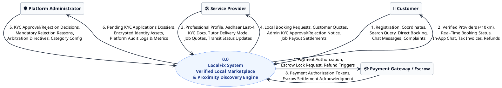

---

### 1.2 DFD Level 1 (Top-Level System Decomposition)
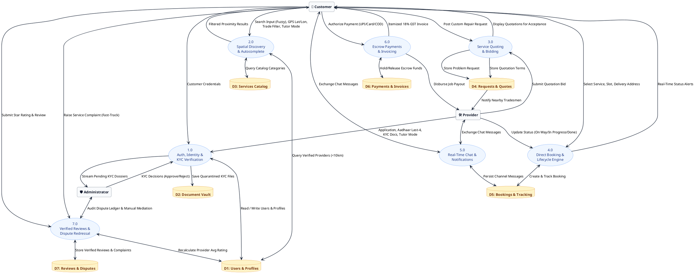

---

### 1.3 DFD Level 2.1 (Provider Registration & KYC Verification)
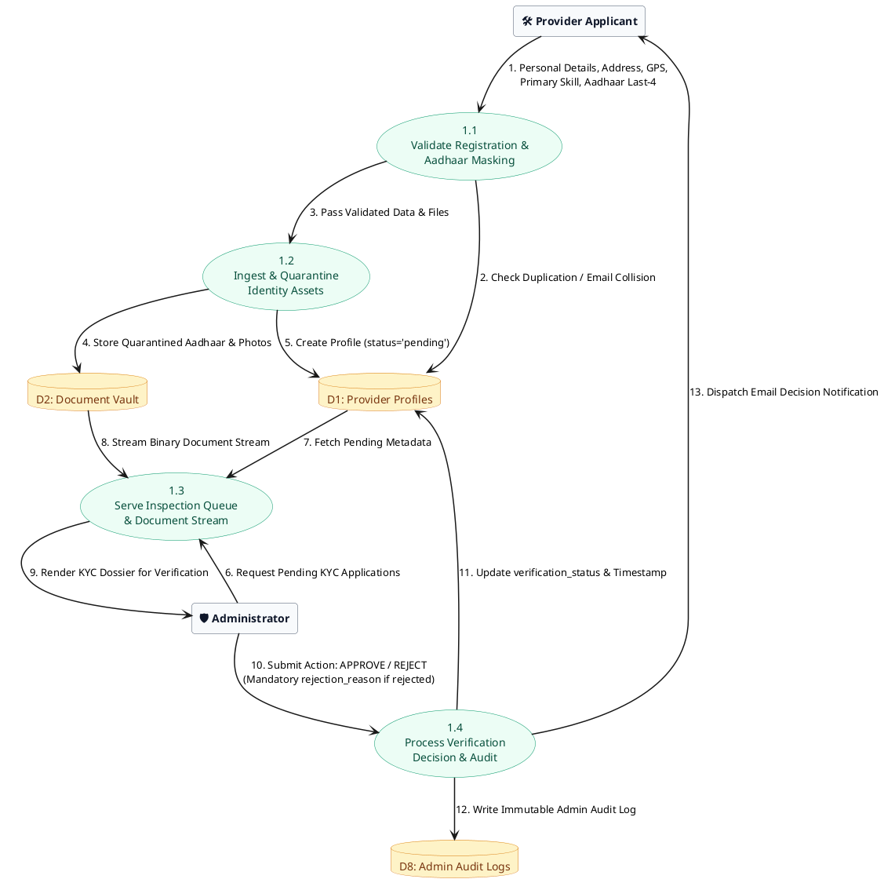

---

### 1.4 DFD Level 2.2 (Spatial Proximity Discovery & Quotation)
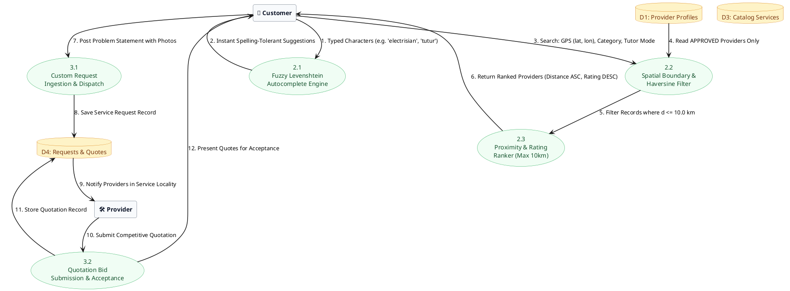

---

### 1.5 DFD Level 2.3 (Direct Booking & Service Execution)
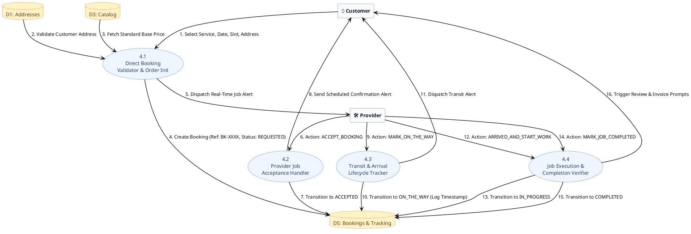

---

### 1.6 DFD Level 2.4 (Escrow Payment & Automated Invoicing)
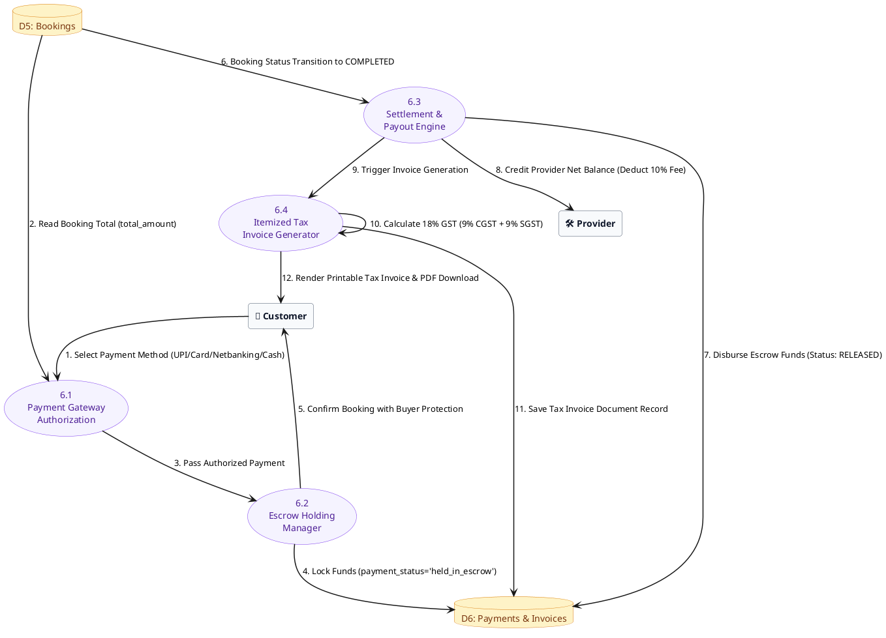

---

### 1.7 DFD Level 2.5 (Dispute Redressal & Redressal Audit)
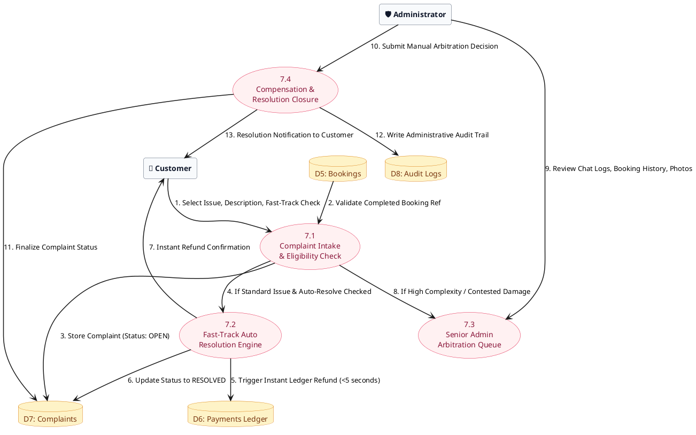

---

## 2. USE CASE DIAGRAMS

### 2.1 Master System Use Case Diagram
```plantuml
@startuml Master_Use_Case
skinparam backgroundColor #FFFFFF
skinparam defaultFontName Arial
skinparam arrowThickness 1.2
skinparam packageStyle rectangle

actor "👤 Customer" as Cust
actor "🛠️ Service Provider" as Prov
actor "🛡️ Platform Administrator" as Admin
actor "💳 Payment Gateway" as Gateway

package "LocalFix Platform System Boundary" {
    
    package "1. Authentication & Profile Security" {
        usecase "UC-1.1: Register as Customer" as UC_RegCust
        usecase "UC-1.2: Register as Verified Provider" as UC_RegProv
        usecase "UC-1.3: Login with JWT Credentials" as UC_Login
        usecase "UC-1.4: Manage Saved Delivery Addresses" as UC_Addresses
    }

    package "2. Search, Discovery & Spatial Proximity" {
        usecase "UC-2.1: Autocomplete Search (Fuzzy Spelled)" as UC_FuzzySearch
        usecase "UC-2.2: Discover Verified Providers (<10km)" as UC_Spatial
        usecase "UC-2.3: Filter Tutors by Mode (Online/Offline)" as UC_Tutors
        usecase "UC-2.4: View Verified Provider Dossier" as UC_ViewProfile
    }

    package "3. Custom Quotes, Direct Booking & Tracking" {
        usecase "UC-3.1: Post Custom Repair Problem" as UC_PostProblem
        usecase "UC-3.2: Submit Quotation Bid" as UC_BidQuote
        usecase "UC-3.3: Direct Book Catalog Service" as UC_DirectBook
        usecase "UC-3.4: Manage Job Transit Status (On Way/Done)" as UC_UpdateStatus
        usecase "UC-3.5: Real-Time GPS Tracking Map" as UC_TrackingMap
    }

    package "4. Financial Escrow, Invoicing & Redressal" {
        usecase "UC-4.1: Authorize Payment into Escrow" as UC_EscrowPay
        usecase "UC-4.2: Download Printable GST Invoice" as UC_Invoice
        usecase "UC-4.3: Submit Verified Review (No Self-Rating)" as UC_Review
        usecase "UC-4.4: File Fast-Track Complaint / Refund" as UC_Dispute
    }

    package "5. Governance, Regulatory KYC & Audit" {
        usecase "UC-5.1: Review Pending KYC & Aadhaar Last-4" as UC_ReviewKYC
        usecase "UC-5.2: Approve Provider Profile" as UC_ApproveKYC
        usecase "UC-5.3: Reject KYC with Mandatory Reason" as UC_RejectKYC
        usecase "UC-5.4: Inspect Security Audit Logs" as UC_AuditLogs
    }
}

' Customer Connections
Cust --> UC_RegCust
Cust --> UC_Login
Cust --> UC_Addresses
Cust --> UC_FuzzySearch
Cust --> UC_Spatial
Cust --> UC_Tutors
Cust --> UC_ViewProfile
Cust --> UC_PostProblem
Cust --> UC_DirectBook
Cust --> UC_TrackingMap
Cust --> UC_EscrowPay
Cust --> UC_Invoice
Cust --> UC_Review
Cust --> UC_Dispute

' Provider Connections
Prov --> UC_RegProv
Prov --> UC_Login
Prov --> UC_BidQuote
Prov --> UC_UpdateStatus
Prov --> UC_Invoice

' Admin Connections
Admin --> UC_Login
Admin --> UC_ReviewKYC
Admin --> UC_ApproveKYC
Admin --> UC_RejectKYC
Admin --> UC_AuditLogs

' Gateway
UC_EscrowPay --> Gateway

@enduml
```

---

### 2.2 Subsystem Specializations & Includes/Extends
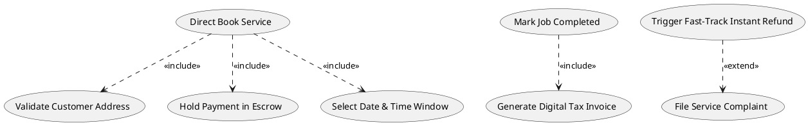

---

## 3. ENTITY-RELATIONSHIP (ER) DIAGRAM

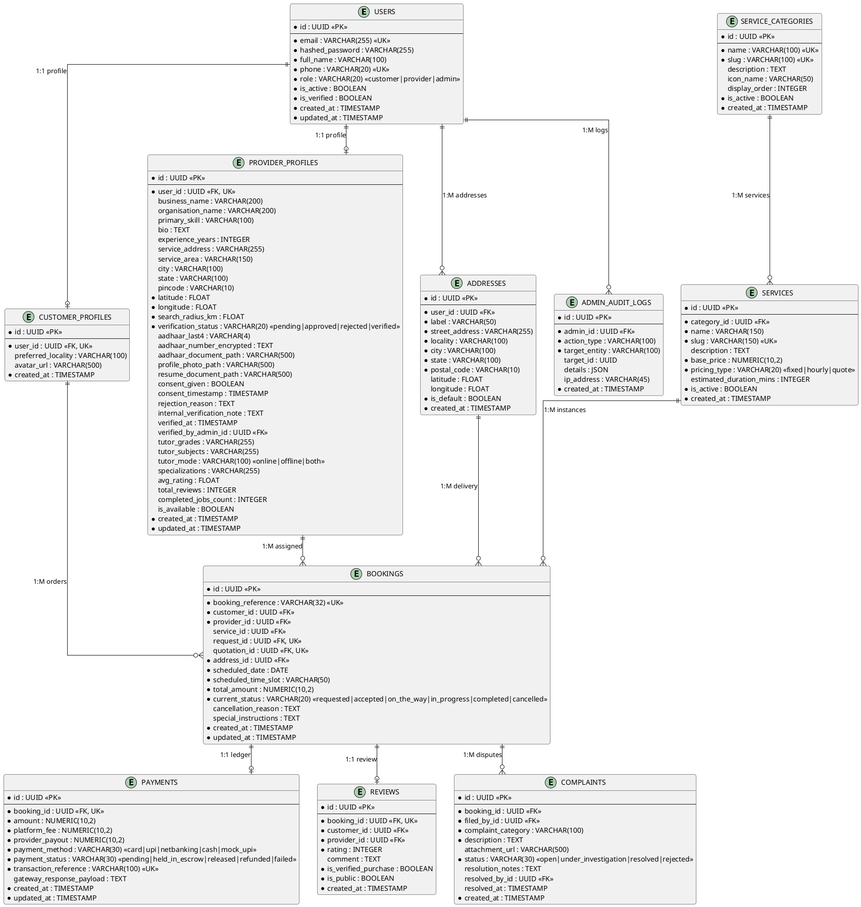

---

## 4. UML CLASS DIAGRAM

```plantuml
@startuml LocalFix_Class_Diagram
skinparam backgroundColor #FFFFFF
skinparam defaultFontName Arial
skinparam classAttributeIconSize 0
skinparam roundCorner 8
skinparam shadowing false

skinparam package {
    BackgroundColor #F8FAFC
    BorderColor #64748B
    FontColor #0F172A
    FontStyle bold
}

skinparam class {
    BackgroundColor #FFFFFF
    BorderColor #2563EB
    HeaderBackgroundColor #EFF6FF
    FontColor #0F172A
    FontSize 11
    ArrowColor #1E293B
}

skinparam enum {
    BackgroundColor #FFFBEB
    BorderColor #D97706
    HeaderBackgroundColor #FEF3C7
    FontColor #78350F
    FontSize 10
}

package "1. Identity & Profiles" {
    enum UserRole {
        CUSTOMER
        PROVIDER
        ADMIN
    }

    enum VerificationStatus {
        PENDING
        UNDER_REVIEW
        APPROVED
        REJECTED
        VERIFIED
        SUSPENDED
    }

    class User {
        +UUID id
        +String email
        +String hashed_password
        +String full_name
        +String phone
        +UserRole role
        +Boolean is_active
        +Boolean is_verified
        +DateTime created_at
        +DateTime updated_at
        +verify_password(plain_pwd: String) : Boolean
        +set_password(plain_pwd: String) : void
        +is_admin() : Boolean
        +is_provider() : Boolean
    }

    class CustomerProfile {
        +UUID id
        +UUID user_id
        +String preferred_locality
        +String avatar_url
        +DateTime created_at
        +get_active_bookings() : List<Booking>
    }

    class ProviderProfile {
        +UUID id
        +UUID user_id
        +String business_name
        +String organisation_name
        +String primary_skill
        +String bio
        +Integer experience_years
        +String service_address
        +String service_area
        +String city
        +String state
        +String pincode
        +Float latitude
        +Float longitude
        +Float search_radius_km
        +VerificationStatus verification_status
        +String aadhaar_last4
        +String aadhaar_document_path
        +String profile_photo_path
        +String resume_document_path
        +Boolean consent_given
        +DateTime consent_timestamp
        +String rejection_reason
        +String internal_verification_note
        +DateTime verified_at
        +UUID verified_by_admin_id
        +String tutor_grades
        +String tutor_subjects
        +String tutor_mode
        +String specializations
        +Float avg_rating
        +Integer total_reviews
        +Integer completed_jobs_count
        +Boolean is_available
        +calculate_distance(cust_lat: Float, cust_lon: Float) : Float
        +update_rating(new_stars: Integer) : void
        +is_eligible_for_discovery() : Boolean
        +submit_kyc(aadhaar_last4: String, doc_path: String) : void
    }

    class Address {
        +UUID id
        +UUID user_id
        +String label
        +String street_address
        +String locality
        +String city
        +String state
        +String postal_code
        +Float latitude
        +Float longitude
        +Boolean is_default
        +get_full_address() : String
        +has_coordinates() : Boolean
    }
}

package "2. Service Catalog & Offerings" {
    enum PricingType {
        FIXED
        HOURLY
        QUOTE_BASED
    }

    class ServiceCategory {
        +UUID id
        +String name
        +String slug
        +String description
        +String icon_name
        +Boolean is_active
        +Integer display_order
        +get_active_services() : List<Service>
    }

    class Service {
        +UUID id
        +UUID category_id
        +String name
        +String description
        +Decimal base_price
        +PricingType pricing_type
        +Integer estimated_duration_mins
        +Boolean is_active
        +calculate_estimate(units: Integer) : Decimal
    }

    class ProviderService {
        +UUID id
        +UUID provider_id
        +UUID service_id
        +Decimal custom_price
        +Boolean is_active
        +get_effective_price() : Decimal
    }

    class ProviderAvailability {
        +UUID id
        +UUID provider_id
        +Integer day_of_week
        +Time start_time
        +Time end_time
        +Boolean is_active
        +is_slot_available(check_time: Time) : Boolean
    }
}

package "3. Booking & Execution" {
    enum BookingStatus {
        REQUESTED
        ACCEPTED
        ON_THE_WAY
        IN_PROGRESS
        COMPLETED
        CANCELLED
        DISPUTED
    }

    class Booking {
        +UUID id
        +String booking_reference
        +UUID customer_id
        +UUID provider_id
        +UUID service_id
        +UUID request_id
        +UUID quotation_id
        +UUID address_id
        +Date scheduled_date
        +String scheduled_time_slot
        +Decimal total_amount
        +BookingStatus current_status
        +String cancellation_reason
        +String special_instructions
        +transition_to(new_status: BookingStatus) : void
        +can_be_cancelled_by(user_id: UUID) : Boolean
        +confirm_completion() : void
    }

    class BookingStatusHistory {
        +UUID id
        +UUID booking_id
        +BookingStatus previous_status
        +BookingStatus new_status
        +UUID changed_by_user_id
        +String change_notes
        +DateTime created_at
    }
}

package "4. Financial & Escrow" {
    enum PaymentMethod {
        CARD
        UPI
        NETBANKING
        CASH
        MOCK_UPI
    }

    enum PaymentStatus {
        PENDING
        HELD_IN_ESCROW
        RELEASED
        REFUNDED
        FAILED
    }

    class Payment {
        +UUID id
        +UUID booking_id
        +UUID customer_id
        +UUID provider_id
        +String transaction_reference
        +Decimal amount
        +PaymentMethod payment_method
        +PaymentStatus payment_status
        +DateTime paid_at
        +hold_in_escrow() : void
        +release_to_provider() : void
        +execute_refund() : void
    }
}

package "5. Custom Requests & Quotations" {
    enum RequestStatus {
        OPEN
        QUOTED
        ACCEPTED
        EXPIRED
        CANCELLED
    }

    enum QuotationStatus {
        SUBMITTED
        ACCEPTED
        REJECTED
        WITHDRAWN
    }

    class ServiceRequest {
        +UUID id
        +UUID customer_id
        +UUID category_id
        +UUID address_id
        +String title
        +String description
        +Date preferred_date
        +String preferred_time_slot
        +String image_url
        +RequestStatus status
        +close_request() : void
        +get_best_quotation() : Quotation
    }

    class Quotation {
        +UUID id
        +UUID request_id
        +UUID provider_id
        +Decimal quoted_amount
        +String work_description
        +Float estimated_duration_hours
        +Date proposed_date
        +String proposed_time_slot
        +String additional_terms
        +QuotationStatus status
        +accept() : void
        +reject() : void
    }
}

package "6. Reputation, Redressal & Audit" {
    class Review {
        +UUID id
        +UUID booking_id
        +UUID customer_id
        +UUID provider_id
        +Integer rating
        +String comment
        +Boolean is_public
        +validate_rating() : Boolean
    }

    enum ComplaintStatus {
        OPEN
        UNDER_INVESTIGATION
        RESOLVED
        REJECTED
    }

    class Complaint {
        +UUID id
        +UUID booking_id
        +UUID filed_by_id
        +String complaint_category
        +String description
        +String attachment_url
        +ComplaintStatus status
        +String resolution_notes
        +UUID resolved_by_id
        +DateTime resolved_at
        +resolve_fast_track(admin_id: UUID, notes: String) : void
        +reject_complaint(admin_id: UUID, notes: String) : void
    }

    class AdminAuditLog {
        +UUID id
        +UUID admin_id
        +String action_type
        +String target_entity
        +UUID target_id
        +JSON details
        +String ip_address
        +DateTime created_at
        +log_action(admin: User, action: String, target: String) : void
    }
}

package "7. In-App Communication" {
    class Conversation {
        +UUID id
        +UUID booking_id
        +UUID customer_id
        +UUID provider_id
        +get_unread_count(user_id: UUID) : Integer
    }

    class Message {
        +UUID id
        +UUID conversation_id
        +UUID sender_id
        +String content
        +Boolean is_read
        +mark_as_read() : void
    }

    class Notification {
        +UUID id
        +UUID user_id
        +String title
        +String message
        +String notification_type
        +String reference_type
        +UUID reference_id
        +Boolean is_read
        +mark_as_read() : void
    }
}

package "8. Domain Engines & Services" {
    class SpatialDiscoveryEngine <<Service>> {
        +compute_haversine(lat1: Float, lon1: Float, lat2: Float, lon2: Float) : Float
        +filter_providers_within_radius(lat: Float, lon: Float, max_radius_km: Float) : List<ProviderProfile>
        +sort_by_proximity_and_rating(providers: List<ProviderProfile>) : List<ProviderProfile>
    }

    class FuzzyAutocompleteEngine <<Component>> {
        +get_levenshtein_distance(s1: String, s2: String) : Integer
        +compute_match_score(query: String, trade_meta: Object) : Integer
        +generate_suggestions(query: String) : List<Suggestion>
    }
}

' ==========================================
' RELATIONSHIPS & ASSOCIATIONS
' ==========================================

' User & Profile Links
User "1" *-- "0..1" CustomerProfile : user_id
User "1" *-- "0..1" ProviderProfile : user_id
User "1" *-- "*" Address : owns
User "1" --> "*" AdminAuditLog : performs
User "1" --> "*" Notification : receives

' Service Catalog Relationships
ServiceCategory "1" *-- "*" Service : categorizes
ProviderProfile "1" *-- "*" ProviderService : offers
Service "1" *-- "*" ProviderService : catalog_ref
ProviderProfile "1" *-- "*" ProviderAvailability : schedules

' Service Requests & Quotations Flow
CustomerProfile "1" --> "*" ServiceRequest : creates
ServiceCategory "1" --> "*" ServiceRequest : categorizes
Address "1" --> "*" ServiceRequest : located_at
ServiceRequest "1" *-- "*" Quotation : receives
ProviderProfile "1" --> "*" Quotation : submits

' Booking Core Links
CustomerProfile "1" --> "*" Booking : books
ProviderProfile "1" --> "*" Booking : services
Service "0..1" --> "*" Booking : service_item
Address "1" --> "*" Booking : service_location
ServiceRequest "0..1" --> "0..1" Booking : originates_from
Quotation "0..1" --> "0..1" Booking : agreed_rate
Booking "1" *-- "*" BookingStatusHistory : status_log

' Payment & Financial
Booking "1" *-- "0..1" Payment : settles_via
CustomerProfile "1" --> "*" Payment : payer
ProviderProfile "1" --> "*" Payment : recipient

' Reviews, Complaints & Audit
Booking "1" *-- "0..1" Review : rated_by
CustomerProfile "1" --> "*" Review : written_by
ProviderProfile "1" --> "*" Review : evaluates
Booking "1" *-- "*" Complaint : disputes
User "1" --> "*" Complaint : files
User "0..1" --> "*" Complaint : resolved_by

' In-App Messaging
Booking "1" *-- "0..1" Conversation : establishes
Conversation "1" *-- "*" Message : contains
User "1" --> "*" Message : sends

' System Engine Queries
SpatialDiscoveryEngine ..> ProviderProfile : filters & ranks
SpatialDiscoveryEngine ..> Address : proximity_center
FuzzyAutocompleteEngine ..> ServiceCategory : searches
FuzzyAutocompleteEngine ..> Service : indexes

@enduml
```

---

## 5. ACTIVITY DIAGRAMS

### 5.1 Activity 1: Provider Onboarding & Admin KYC Inspection
```plantuml
@startuml Activity_Provider_KYC
skinparam backgroundColor #FFFFFF
skinparam defaultFontName Arial

start
:Provider Applicant fills Registration Form;
:Input Personal Details, Experience, Service Locality;
:Enter Aadhaar Last-4 Digits (XXXX-XXXX-1234);

if (Is Teaching / Tutor Trade?) then (yes)
    :Select Teaching Delivery Mode\n(Online, Offline Home Tuition, or Both);
    :Input Curriculum Standards & Subjects;
else (no)
    :Select Standard Trade Skill;
endif

:Upload Government Aadhaar Card & Profile Photo;
:Provide Regulatory Verification Consent;
:Submit Application to LocalFix Backend;

:Backend validates Aadhaar Last-4 & mandatory attributes;
:Quarantine uploaded files in Secure Storage Vault;
:Create ProviderProfile with status = PENDING;

|Administrator|
:Open Pending KYC Verification Dashboard;
:Inspect Applicant Profile, Trade & Address;
:Stream & Review Uploaded Aadhaar & Photo;

if (Are Credentials Authentic and Legible?) then (yes)
    :Click "Approve Verification";
    :Update verification_status = APPROVED;
    :Write Action to Admin Audit Log;
    :Dispatch Approval Notification Email;
    :Profile becomes Discoverable within 10 km;
    stop
else (no)
    :Click "Reject Application";
    :Enter Mandatory Written Rejection Reason;
    :Update verification_status = REJECTED;
    :Write Action to Admin Audit Log;
    :Dispatch Rejection Notice with Reason;
    :Applicant may log in & upload valid docs;
    stop
endif
@enduml
```

---

### 5.2 Activity 2: Customer Discovery, Direct Booking & Escrow Settlement
```plantuml
@startuml Activity_Booking_Escrow
skinparam backgroundColor #FFFFFF
skinparam defaultFontName Arial

start
:Customer enters Search Term (with Fuzzy Autocomplete);
:System computes Levenshtein Distance & renders suggestions;
:Customer selects Category, GPS Locality & Tutor Mode;

:Backend filters APPROVED providers where Haversine Distance <= 10.0 km;
:Customer browses verified profiles & reviews;
:Click "Book Appointment / Tuition Session";

:Select Service, Date, Time Slot & Delivery Address;
:Choose Payment Method (UPI / Card / Netbanking / COD);
:Backend authorizes transaction & locks funds in Escrow Vault\n(status = HELD_IN_ESCROW);
:Create Booking with status = REQUESTED;

|Service Provider|
:Receive Real-time Job Dispatch Notification;
:Accept Booking (status -> ACCEPTED);
:Depart for Job Site (status -> ON_THE_WAY);
:Arrive at Customer Premises (status -> IN_PROGRESS);
:Perform Verified Service / Tuition;
:Mark Job as Completed (status -> COMPLETED);

|Customer|
:Inspect Service Quality & Sign off;
:Release Escrow Payment to Provider (status -> RELEASED);
:System auto-generates Itemized 18% GST Tax Invoice;
:Customer downloads printable PDF Invoice;
:Submit 1-5 Star Rating & Verified Review;
stop
@enduml
```

---

### 5.3 Activity 3: Fast-Track Dispute Redressal & Instant Refund
```plantuml
@startuml Activity_Dispute_Redressal
skinparam backgroundColor #FFFFFF
skinparam defaultFontName Arial

start
:Customer identifies issue on completed booking;
:Open "File Service Complaint" modal;
:Select Issue Category (Quality, Delay, Pricing, Damage);
:Enter descriptive explanation of defect;

if (Customer checks Fast-Track Auto-Resolution?) then (yes)
    :System evaluates Complaint Category;
    if (Category is Standard Quality/Delay?) then (yes)
        :Trigger Instant Automated Resolution;
        :Execute Escrow Ledger Refund to Customer (< 5s);
        :Update Complaint status = RESOLVED;
        :Update Booking status = DISPUTED_REFUNDED;
        :Notify Customer of credited balance;
        stop
    else (Complex Property Damage)
        :Escalate to Senior Support Queue;
    endif
else (no)
    :Route to Admin Arbitration Queue;
endif

|Administrator|
:Senior Officer inspects Complaint Dossier;
:Review Chat History, Time Stamps & Work Details;
:Call Customer & Provider for Mediation;

if (Approve Customer Claim?) then (yes)
    :Authorize Full / Partial Ledger Refund;
    :Update Complaint status = RESOLVED;
else (no)
    :Reject Claim with Evidence Notes;
    :Update Complaint status = REJECTED;
endif

:Write Action to Admin Audit Trail;
stop
@enduml
```

---

## 6. SEQUENCE DIAGRAMS

### 6.1 Sequence 1: Customer Booking, Provider Lifecycle & Completion
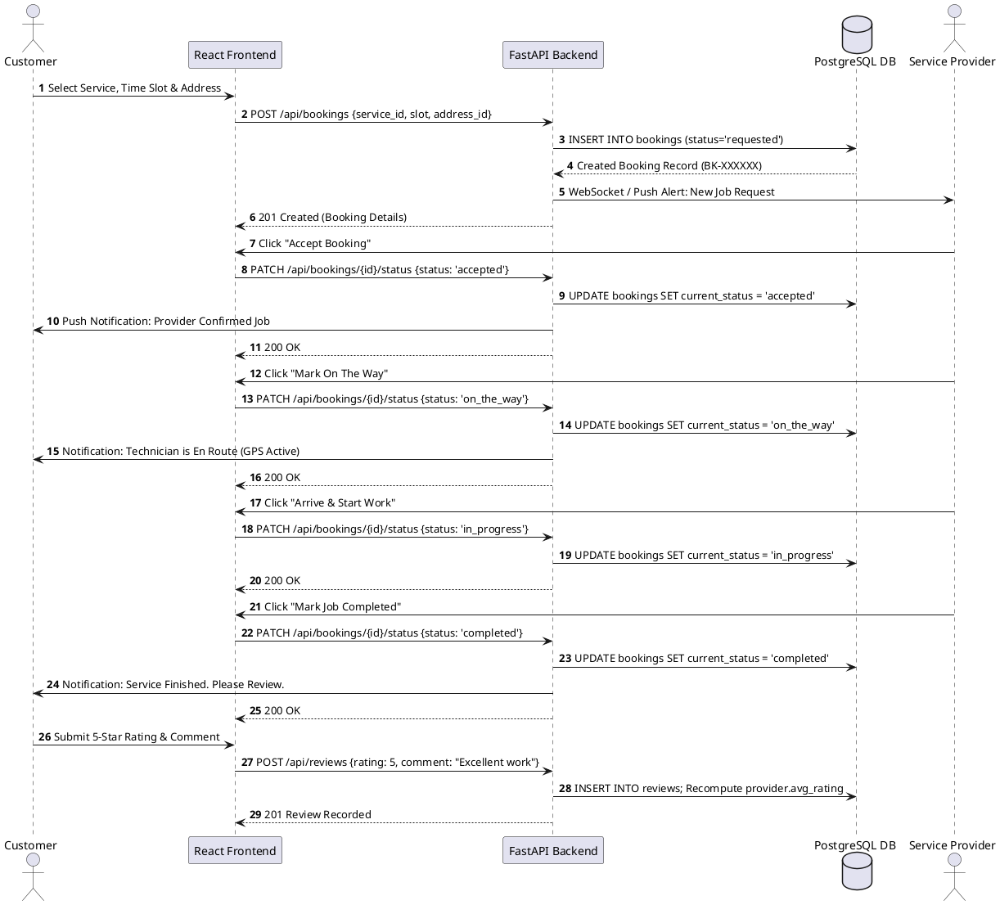

---

### 6.2 Sequence 2: Provider KYC Submission, Aadhaar Review & Admin Decision
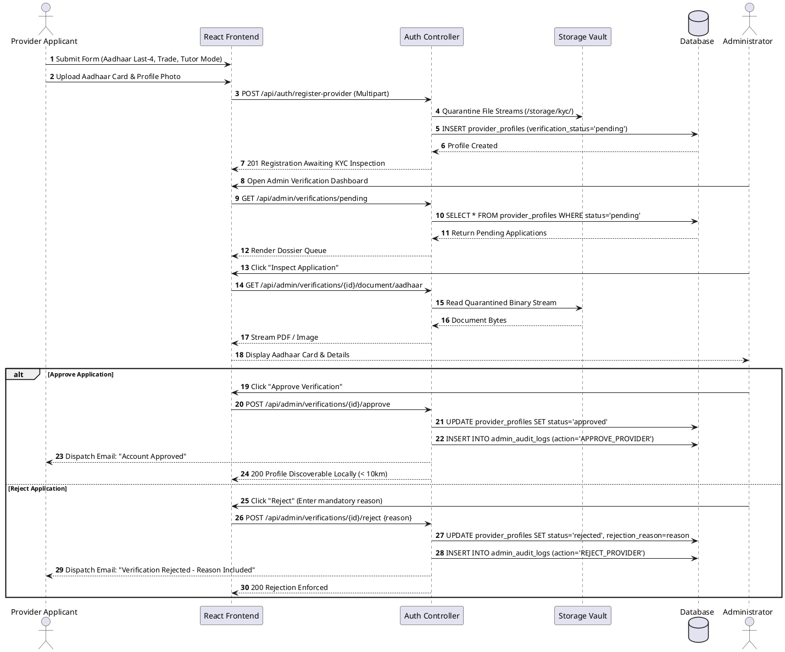

---

### 6.3 Sequence 3: Payment Checkout, Escrow Holding & Tax Invoicing
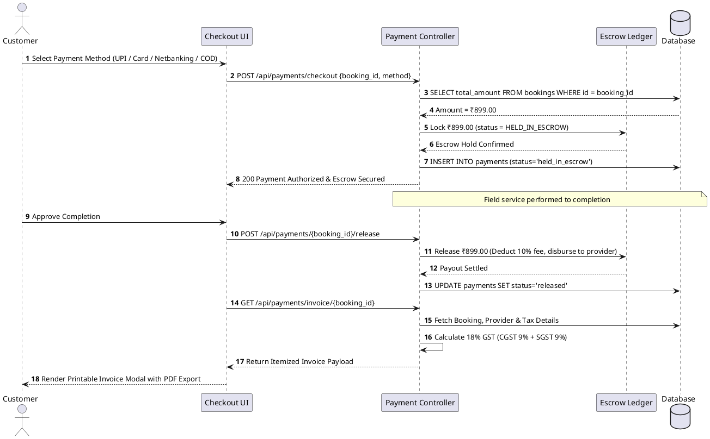

---

## 7. STATE MACHINE DIAGRAMS

### 7.1 State 1: Booking Lifecycle States
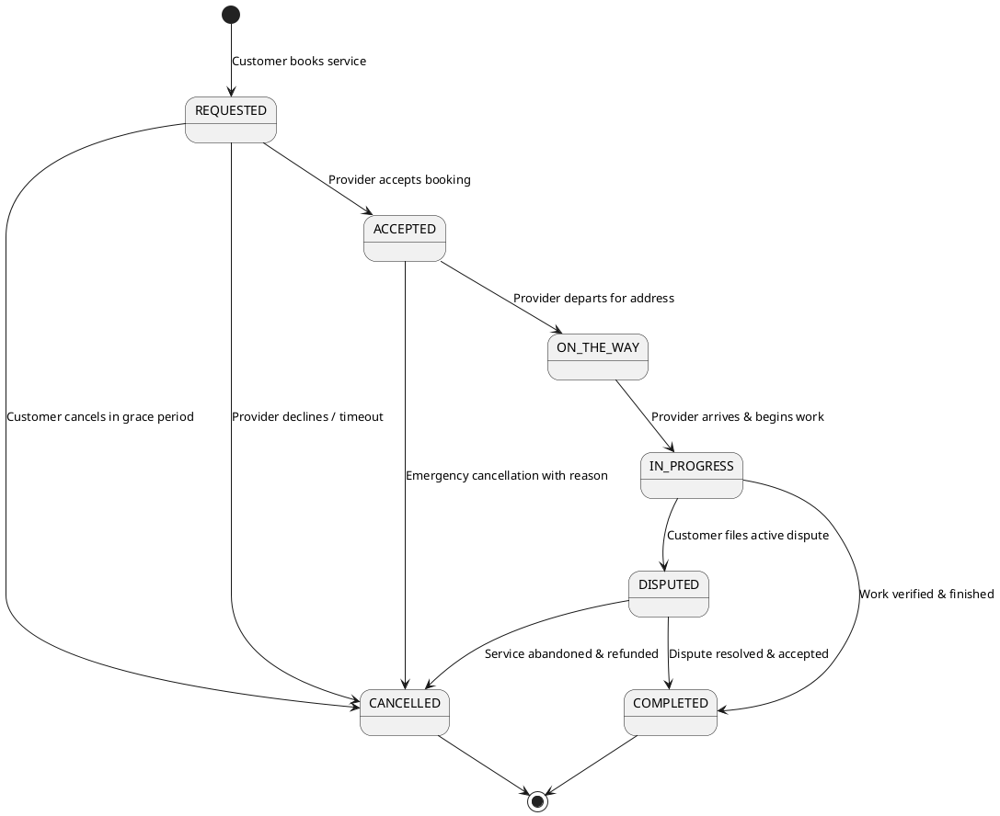

---

### 7.2 State 2: Provider Verification Status States
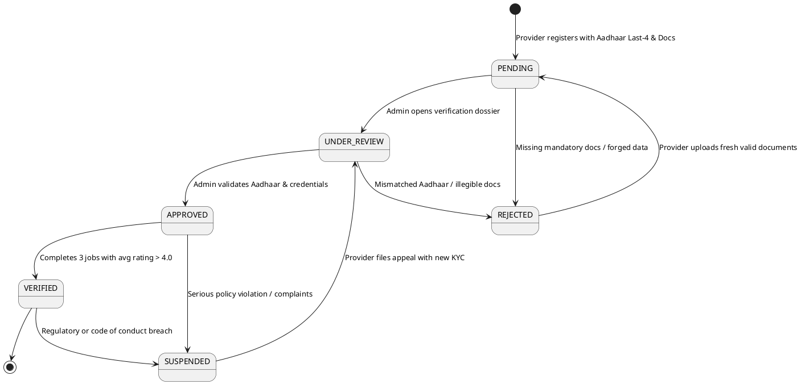

---

### 7.3 State 3: Dispute Resolution States
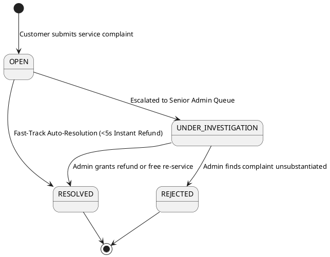

---

## 8. COMPONENT & DEPLOYMENT ARCHITECTURE DIAGRAM

```plantuml
@startuml Component_Deployment_Architecture
skinparam backgroundColor #FFFFFF
skinparam defaultFontName Arial

node "Client Tier (End-User Device)" {
    component [Browser Client] as Browser {
        package "React 18 SPA (Vite)" {
            [TailwindCSS Design System]
            [SearchAutocomplete (Levenshtein)]
            [Leaflet Map GIS Engine]
            [React ErrorBoundary]
        }
    }
}

node "Reverse Proxy & Web Server" {
    component [Nginx Proxy / Port 80, 443] as Nginx
}

node "Application Server Tier" {
    component [FastAPI ASGI App / Port 8000] as FastAPI {
        [Uvicorn Async Event Loop]
        [Spatial Haversine Engine (10km)]
        [Escrow Ledger Controller]
        [Tax Invoice Generator]
        [JWT & RBAC Middleware]
    }
}

node "Storage & Persistence Tier" {
    database "PostgreSQL 16 Engine" as DB {
        [UUID-OSSP Extension]
        [Users & Profiles Tables]
        [Bookings & Status Tracking]
        [Payments & Invoices]
        [Complaints & Audit Logs]
    }
    
    folder "Quarantined Storage Vault" as Vault {
        [/storage/kyc/ (Encrypted Documents)]
        [/storage/photos/ (Avatars)]
    }
}

cloud "External Services" {
    [OpenStreetMap / Carto CDN] as OSM
    [Mock Payment Gateway] as Gateway
}

Browser --> Nginx : HTTPS / WSS
Nginx --> FastAPI : ASGI Proxy
FastAPI --> DB : SQLAlchemy 2.0 ORM Connection Pool
FastAPI --> Vault : Restricted Stream I/O
Browser --> OSM : Vector Cartographic Tiles
FastAPI --> Gateway : Payment Authorization

@enduml
```

---
**End of PlantUML Diagram Specifications**  
*LocalFix Verification, Proximity Discovery & Marketplace Platform*
