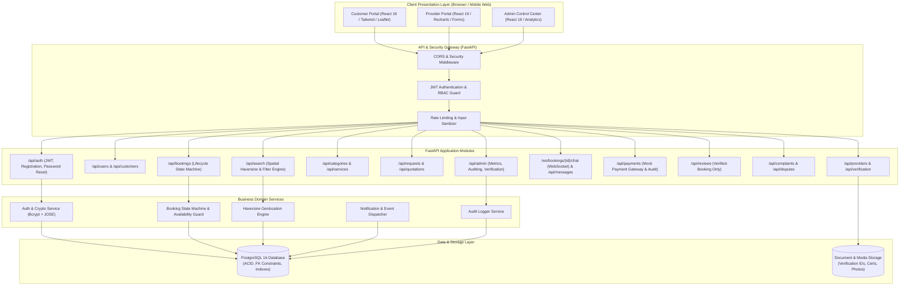

# LocalFix — System Architecture Document
**Project:** LocalFix — Verified Local Service Marketplace  
**Institution:** Aligarh Muslim University (AMU), MCA Programme  
**Target Locality:** Aligarh (Expandable to National / Global multi-city)

---

## 1. High-Level Architectural Pattern

LocalFix employs a **decoupled, multi-tier Client-Server Architecture** adhering to clean architecture principles:

1. **Presentation Tier (Frontend Client)**:
   - Single Page Application (SPA) built with **React 19** and **Vite**.
   - **Tailwind CSS** for responsive design system.
   - **React Router v7** for declarative role-based routing (Public, Customer, Provider, Admin).
   - **Leaflet & OpenStreetMap** for interactive geospatial location selection and provider mapping.
   - **Recharts** for administrative and provider dashboard data visualization.
   - **Axios** with global interceptors for JWT token attachment and HTTP error handling.
   - Native **WebSocket client** for low-latency live messaging during active service bookings.

2. **Application Tier (Backend API & Services)**:
   - Asynchronous Python RESTful API built on **FastAPI** running on **Uvicorn** with **uvloop**.
   - **Role-Based Access Control (RBAC)** middleware and dependency injection enforcing Customer, Provider, and Admin privileges.
   - **Pydantic v2** validation and serialization schemas for rigorous input sanitization and DTO generation.
   - **WebSocket Connection Manager** maintaining active booking chat channels with authorization checks.
   - Modular Service-Repository Pattern isolating business rules from data-access logic.

3. **Data Tier (Persistence & Storage)**:
   - **PostgreSQL 16** relational database ensuring ACID transactions, foreign key integrity, and constraint enforcement.
   - **SQLAlchemy 2.0 ORM** with modern type-annotated Declarative Base models.
   - **Alembic** for tracked, reversible database schema migrations.
   - Optimized B-tree indexes and spatial coordinate querying (Haversine formula in SQL) for radial distance filtering around Aligarh coordinates (e.g. Center: 27.8974° N, 78.0880° E).

---

## 2. System Architecture Diagram

---

## 3. Security Architecture
- **Password Security**: Passwords hashed using standard `bcrypt` with dynamic salting. Plaintext passwords never logged or persisted.
- **Token Security**: Stateless JWT access tokens signed with HMAC-SHA256 (`HS256`). Claims include `sub` (user_id), `role`, `email`, and expiration (`exp`).
- **Authorization Enforcement**: Strict dependency injection guards:
  - `get_current_active_user`
  - `require_role(["customer"])`
  - `require_role(["provider"])`
  - `require_role(["admin"])`
- **Ownership Verification**: Resource-level checks prevent User A from viewing or modifying User B's bookings, quotations, or chat messages.
- **SQL Injection Prevention**: 100% parameterized queries via SQLAlchemy 2.0 ORM expressions.
