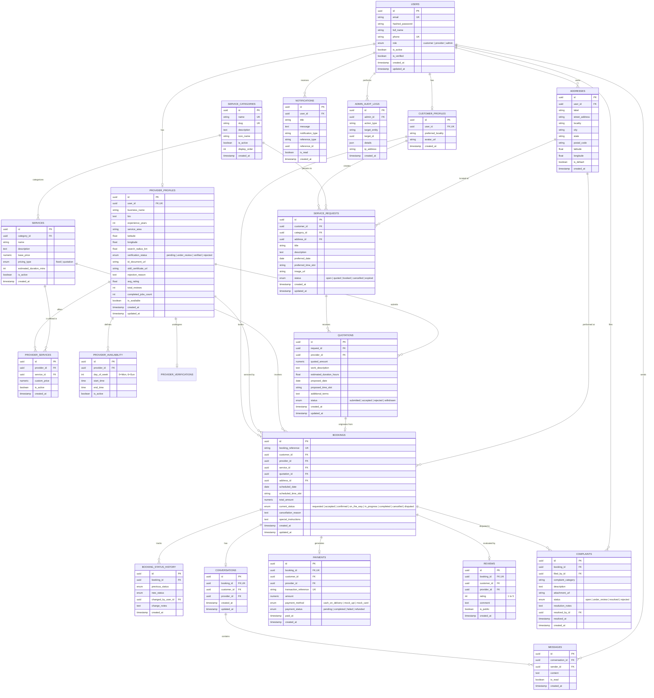

# LocalFix — Database Design & Entity-Relationship Specification
**Database Engine:** PostgreSQL 16  
**ORM:** SQLAlchemy 2.0  
**Migration Tool:** Alembic

---

## 1. Entity-Relationship (ER) Diagram

---

## 2. Booking State Machine Transitions

| From Status | Permitted To Status | Authorized Actor | Action / Trigger |
| :--- | :--- | :--- | :--- |
| `requested` | `accepted` | Provider | Provider agrees to customer request |
| `requested` | `cancelled` | Customer / Provider | Cancellation before acceptance |
| `accepted` | `confirmed` | Customer / System | Customer confirms date/schedule or payment |
| `accepted` | `cancelled` | Customer / Provider | Cancellation prior to final confirmation |
| `confirmed` | `on_the_way` | Provider | Provider departs for customer location |
| `confirmed` | `cancelled` | Customer / Provider | Late cancellation with reason |
| `on_the_way` | `in_progress` | Provider | Provider arrives and begins work |
| `in_progress` | `completed` | Provider | Provider finishes work |
| `in_progress` | `disputed` | Customer / Provider | Work stoppage, disagreement, damage |
| `completed` | `disputed` | Customer | Unsatisfactory work / billing dispute |
| `disputed` | `resolved` / `rejected` | Admin | Administrative dispute resolution |

---

## 3. Database Indexes for Performance

1. `users(email)`: Unique index for fast login query.
2. `provider_profiles(latitude, longitude)`: B-tree spatial index for fast distance calculations.
3. `provider_profiles(verification_status, is_available)`: Filter index for marketplace listings.
4. `bookings(customer_id, current_status)` and `bookings(provider_id, current_status)`: Compound indexes for active dashboard booking queries.
5. `bookings(booking_reference)`: Unique index for quick lookup.
6. `messages(conversation_id, created_at)`: Chronological ordering for chat history.
7. `notifications(user_id, is_read)`: Fast unread notification badge counts.
8. `reviews(provider_id)`: Aggregate rating calculations.
