# LocalFix — System Requirements & Use-Case Specification
**Academic Project:** Master of Computer Applications (MCA), Aligarh Muslim University (AMU)  
**System:** LocalFix — Verified Local Service Marketplace

---

## 1. System Use-Case Diagram

```mermaid
graph LR
    Customer((Customer))
    Provider((Service Provider))
    Admin((Administrator))

    subgraph AuthModule ["1. Authentication & Profile"]
        UC1[Register & Login with JWT]
        UC2[Manage Profile & Addresses]
    end

    subgraph DiscoveryModule ["2. Search & Discovery"]
        UC3[Browse Categories & Services]
        UC4[Location-based Search with Leaflet]
        UC5[Filter by Price, Rating, Verification]
        UC6[View Verified Provider Details]
    end

    subgraph RequestModule ["3. Requests & Quotations"]
        UC7[Post Service Request with Photos]
        UC8[View Requests in Service Area]
        UC9[Submit Quotation with Terms]
        UC10[Accept / Reject Quotation]
    end

    subgraph BookingModule ["4. Booking & Execution"]
        UC11[Book Appointment]
        UC12[Track Booking Status Lifecycle]
        UC13[Update Job Status: On Way / In Progress / Completed]
        UC14[Simulate Payment Mock Gateway]
    end

    subgraph TrustModule ["5. Trust, Chat & Dispute"]
        UC15[Live Booking Chat via WebSockets]
        UC16[Submit Rating & Verified Review]
        UC17[Raise Complaint / Dispute]
        UC18[Receive In-App Notifications]
    end

    subgraph AdminModule ["6. Administration & Control"]
        UC19[Review & Verify Provider Documents]
        UC20[Manage Categories & Platform Services]
        UC21[Monitor Bookings & Resolve Disputes]
        UC22[Platform Analytics & Audit Trail]
    end

    %% Customer Connections
    Customer --> UC1
    Customer --> UC2
    Customer --> UC3
    Customer --> UC4
    Customer --> UC5
    Customer --> UC6
    Customer --> UC7
    Customer --> UC10
    Customer --> UC11
    Customer --> UC12
    Customer --> UC14
    Customer --> UC15
    Customer --> UC16
    Customer --> UC17
    Customer --> UC18

    %% Provider Connections
    Provider --> UC1
    Provider --> UC2
    Provider --> UC8
    Provider --> UC9
    Provider --> UC12
    Provider --> UC13
    Provider --> UC15
    Provider --> UC17
    Provider --> UC18

    %% Admin Connections
    Admin --> UC1
    Admin --> UC19
    Admin --> UC20
    Admin --> UC21
    Admin --> UC22
```

---

## 2. Role-Based Access Control (RBAC) Matrix

| Feature / Action | Customer | Provider | Admin | Public |
| :--- | :---: | :---: | :---: | :---: |
| Browse Categories & Active Services | ✅ | ✅ | ✅ | ✅ |
| Search Verified Providers by Location/Price | ✅ | ✅ | ✅ | ✅ |
| Register & Login | ✅ | ✅ | ✅ | ❌ |
| Manage Saved Addresses | ✅ | ❌ | ❌ | ❌ |
| Create Service Request | ✅ | ❌ | ❌ | ❌ |
| View Service Requests & Submit Quotation | ❌ | ✅ (Verified only) | ❌ | ❌ |
| Accept Quotation & Book Appointment | ✅ | ❌ | ❌ | ❌ |
| Transition Booking: Requested -> Accepted | ❌ | ✅ | ❌ | ❌ |
| Transition Booking: Confirmed -> On the Way -> In Progress -> Completed | ❌ | ✅ | ❌ | ❌ |
| Cancel Booking | ✅ (Restricted) | ✅ (Restricted) | ✅ (Any) | ❌ |
| Live Chat on Active Booking | ✅ (Participant) | ✅ (Participant) | ❌ | ❌ |
| Mock Payment Checkout | ✅ | ❌ | ❌ | ❌ |
| Submit Review on Completed Booking | ✅ (Verified Customer) | ❌ | ❌ | ❌ |
| Submit Verification Documents | ❌ | ✅ | ❌ | ❌ |
| Approve / Reject Provider Verification | ❌ | ❌ | ✅ | ❌ |
| Manage Service Categories & Master Services | ❌ | ❌ | ✅ | ❌ |
| Resolve Complaints & Disputes | ❌ | ❌ | ✅ | ❌ |
| View Platform Metrics & Audit Logs | ❌ | ❌ | ✅ | ❌ |

---

## 3. Prioritized MVP Feature List

### P0 (Mandatory Core Foundation)
1. **JWT Authentication & RBAC**: Customer, Provider, Admin registration & login with secure bcrypt passwords and token verification.
2. **Category & Service Catalog**: Managed categories (Electrician, Plumber, AC Repair, Carpenter, Painter, Cleaning, Laptop Repair) with pricing models.
3. **Provider Profile & Verification Workflow**: Professional profile with experience, skills, service radius, and document submission with Admin verification review.
4. **Location-Based Search Engine**: Search providers by category and distance from user's address/coordinates in Aligarh (e.g., Civil Lines, Medical Colony, Shamshad Market, Dodhpur, Ramghat Road).
5. **Request & Quotation Pipeline**: Customers submit requests; nearby verified providers quote price & duration; customers accept/reject.
6. **Booking Lifecycle State Machine**: Full lifecycle tracking (`requested` → `accepted` → `confirmed` → `on_the_way` → `in_progress` → `completed`).
7. **Mock Payment Processing**: Clear mock gateway recording payment references, statuses (`pending`, `completed`), and linking to bookings.
8. **Verified Booking Reviews**: 1–5 star ratings and comments restricted strictly to completed bookings.
9. **Role-Tailored Dashboards**: Clean, interactive dashboards for Customer, Provider, and Admin.

### P1 (Communication, Trust & Governance)
1. **Live Booking Messaging**: Real-time WebSocket chat and persistent message history between booking participants.
2. **In-App Notifications**: Real-time event notifications (quote received, booking confirmed, status updated).
3. **Dispute & Complaint Redressal**: Customer complaint submission and Admin dispute resolution workflow with audit trail.
4. **Admin Analytics Dashboard**: Recharts-powered metrics (total users, active bookings, revenue, category distribution).

### P2 (Enhancements & Polish)
1. Interactive Leaflet Map for spatial provider visualization.
2. Multi-city expansion readiness (extensible postal code / locality structure).
3. Exportable audit reports for administrative review.
